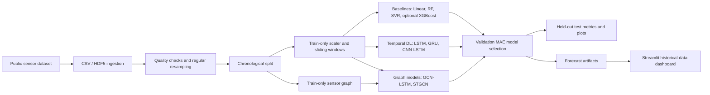

# Architecture, modeling rationale, and roadmap

## Data-to-forecast architecture

## Model intuition

For a sensor signal \(x_{i,t}\), the forecaster receives the most recent \(L\) samples across all sensors and estimates the value \(h\) minutes ahead.

- **Linear regression:** a direct affine map from flattened recent windows to all sensor targets. Fast and interpretable but cannot represent complex nonlinearities.
- **Random forest:** an ensemble of decision trees over the same window features. Captures nonlinear interactions but does not inherently understand temporal or network structure.
- **SVR:** kernel regression for nonlinear patterns. The multi-output wrapper trains one estimator per sensor; runtime and memory can grow substantially.
- **XGBoost:** boosted trees with nonlinear feature interactions. Optional dependency; still treats sensor-window features as tabular input.
- **LSTM / GRU:** recurrent gates retain useful temporal state. GRU is typically smaller; both model each sensor's history independently in this implementation.
- **CNN-LSTM:** a temporal convolution extracts short local patterns before recurrent processing; it remains sensor-independent.
- **GCN-LSTM:** normalized adjacency aggregation mixes each sensor's features with its graph neighbors at each time step, then an LSTM models the resulting per-node history. This compact graph-temporal baseline can transfer information across connected sensors but is only as meaningful as its graph.
- **STGCN:** gated temporal convolutions surround a spatial graph-convolution layer to jointly model recent dynamics and neighbor effects. This compact implementation is not a reproduction of a specific paper's full architecture or training protocol.

## Mathematical view and trade-offs

Let \(X_{t-L+1:t}\) be the recent \(L\)-step sensor window and \(A\) the normalized sensor adjacency. The prediction is a direct horizon-specific map \(f_\theta(X_{t-L+1:t}, C_{t-L+1:t}, A)\), where \(C\) contains known cyclical calendar features. Each horizon is trained separately.

| Model | Core computation | Strength | Limitation |
|---|---|---|---|
| Linear regression | \(\hat y = XW+b\) | Fast, transparent baseline | Only linear relationships |
| Random forest | Average of tree regressors | Nonlinear and robust to feature interactions | Large flattened windows can be costly; no native graph structure |
| SVR | Kernel regression per sensor | Effective on modest nonlinear datasets | Training can be slow and scales poorly with samples |
| XGBoost | Additive gradient-boosted trees | Strong tabular baseline | No native temporal or spatial state |
| LSTM / GRU | Recurrent gated hidden state \(h_t = g(x_t,h_{t-1})\) | Learns temporal dependencies | This implementation processes sensors independently |
| CNN-LSTM | Temporal convolution followed by recurrence | Captures local temporal motifs and longer state | No spatial mixing; more parameters than simple baselines |
| GCN-LSTM | \(H_t = \sigma([X_t,\hat A X_t]W)\), then recurrent modeling | Uses information from connected sensors | Quality depends on graph validity; correlation is not road topology |
| STGCN | Gated temporal convolution, spatial graph convolution, gated temporal convolution | Joint local temporal and spatial modeling | Compact implementation; more data/tuning needed and still dependent on graph quality |

For the graph models, \(\hat A = D^{-1/2}(A+I)D^{-1/2}\). The spatial operation combines a node's own features and its normalized neighbors; the STGCN temporal gate is \(\tanh(P) \odot \operatorname{sigmoid}(Q)\). All listed implementations live in `src/models.py` and use the same chronological data splits and per-horizon target definition.

Inputs combine each sensor's normalized history with cyclical hour-of-day, day-of-week, and annual time features. These calendar signals are known at forecast time and do not use future observed traffic.

The graph is either a Gaussian kernel over provided sensor coordinates (cut off beyond 5 km) or absolute pairwise speed correlation estimated on training data only. Correlation is a fallback statistical association, not a road-network topology. For deployment, use a verified road graph and document its sensor-to-road mapping.

## Evaluation protocol

Rows are split in time before sequence construction. Scalers fit only on training observations. A sequence's partition is assigned from its target timestamp; its feature window contains only observations before that target. Validation MAE selects a model separately at each forecast horizon. Final metrics use the later test targets. MAPE excludes near-zero denominators, and R² is reported over all sensor-target pairs.

Do not compare runs with different source datasets, units, sensor populations, temporal splits, or missing-data policy as if they were controlled experiments. For a research report, record data release/version, exact sensor list, package versions, random seed, split dates, and hyperparameters alongside metrics.

## Smart-city roadmap

1. Add an auditable dataset adapter for a chosen release and its published sensor graph.
2. Add multivariate targets and weather/incident features where observations are available.
3. Benchmark against persistence, seasonal-naive forecasts, STGCN, and DCRNN under identical splits.
4. Add rolling-origin evaluation, calibration/uncertainty intervals, sensor-level error analysis, and model drift checks.
5. Integrate a licensed, monitored streaming feed; visibly separate live readings from historical observations.
6. Validate with traffic operators before using forecasts for signal-management recommendations.
7. Treat emergency routing and signal control as separately engineered, safety-reviewed future systems.

Potential benefits—less delay, better bus operations, emissions reduction—must be measured in a controlled pilot; they are not guaranteed model outcomes.
